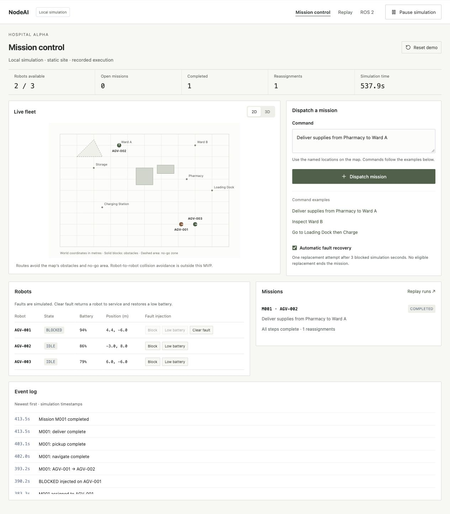
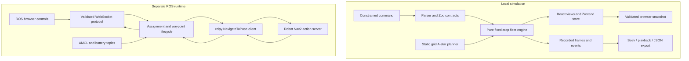
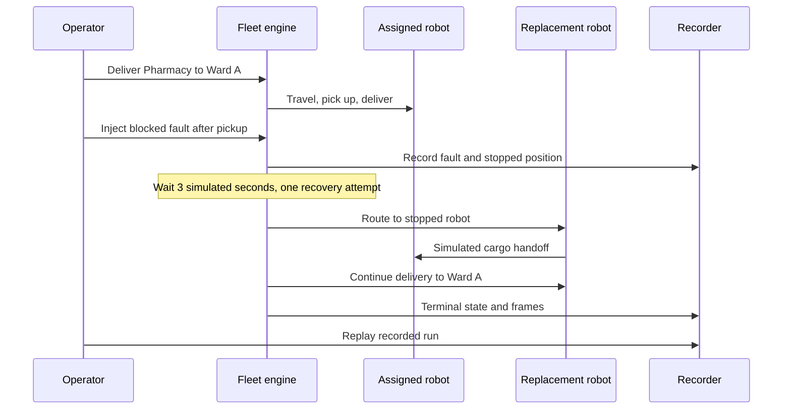
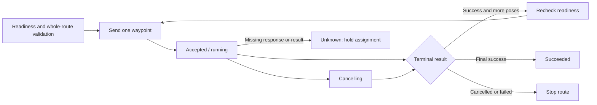
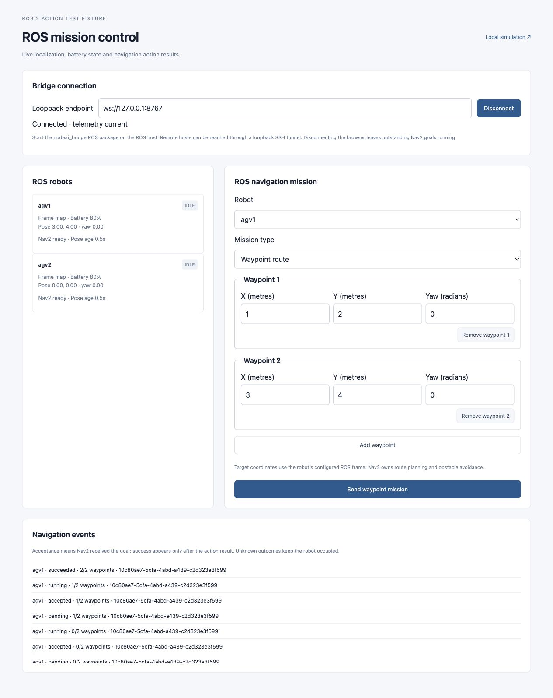

# NodeAI

[](https://github.com/Ekanshthegreat/NodeAI-rework/actions/workflows/ci.yml)

Robot mission simulation and a ROS 2 Jazzy bridge for Nav2 navigation.

[Try the browser demo](https://ekanshthegreat.github.io/NodeAI-rework/) ·
[Architecture](docs/ARCHITECTURE.md) · [ROS deployment](docs/ROS2.md) ·
[Demo scenarios](docs/DEMO.md) · [Release history](CHANGELOG.md)

NodeAI turns a constrained command into a validated mission, executes it through
an explicit state machine, and records what happened for playback. Its ROS path
sends single-pose or sequential waypoint goals through actual Jazzy action
clients. The browser simulator runs without hardware, accounts or a backend.



| Local browser simulator | ROS 2 / Nav2 bridge |
| --- | --- |
| A* on a static map; three point-agent robots | Nav2 owns planning, costmaps and motion |
| Navigation, delivery, inspection, charge and dock | Single pose or 1–20 sequential navigation poses |
| One bounded replacement attempt and simulated cargo handoff | Hold assignment through cancellation and uncertain outcomes |
| Browser snapshots, recorded playback and JSON export | Real localization/battery subscriptions and action feedback |
| 94 TypeScript behavior tests | 23 lifecycle tests + 7 real ROS interface tests |

The live Pages demo runs the local simulator. ROS control needs a separately
running bridge; its validated test fixture is not a physical robot deployment.

## Execution paths



The simulator owns simulated state; Nav2 owns robot navigation. The two paths
share a workspace, not an execution engine. UI components derive their displays
from state and events rather than inventing completion.

## What happens when a robot fails?



Recovery can fail: no eligible replacement, an unreachable route or an exhausted
retry budget produces a visible terminal failure. The simulator's cargo handoff
is a modeled operation, not a robot protocol.

## Design choices

| Decision | Why it matters | Evidence |
| --- | --- | --- |
| Pure fixed-step engine | Repeatable state transitions independent of React effects | [Engine and fault tests](src/simulation/engine.test.ts) |
| Validate before dispatch | Unsupported commands and unreachable routes never start execution | [Planner tests](src/lib/planner.test.ts) |
| Bounded retries and history | Recovery and recording cannot grow indefinitely | [Engine](src/simulation/engine.ts), [persistence](src/simulation/persistence.ts) |
| Playback reads recorded frames | Inspect the actual retained run without re-executing it | [Replay lookup](src/simulation/replay.ts) |
| Per-leg callback generations | Late feedback from a finished waypoint cannot mutate its successor | [ROS lifecycle tests](ros2/nodeai_bridge/test/test_gateway.py) |
| Cancel acknowledgement is not completion | Keep the robot assigned until its terminal action result | [Gateway](ros2/nodeai_bridge/nodeai_bridge/gateway.py) |

## Run it

Use Node.js 24 (`.nvmrc` is included), then:

```sh
npm ci
npm run dev
```

Open the local URL printed by Vite and choose **Open mission control**. No `.env`
file is required for the local demo. For a production build, run `npm run build`
and `npm run preview`. Deploy `dist/` on a static host with all application paths
rewritten to `index.html`; `/app` and `/app/replay` are client routes. The Pages
workflow uses the repository asset base and hash routes, so direct links and
refreshes work on GitHub's static host. To check that build locally:

```sh
VITE_ROUTER=hash npm run build -- --base=/NodeAI-rework/
npm run preview -- --base=/NodeAI-rework/
```

Open `/NodeAI-rework/#/app` on the preview server. Pages deployment follows a
successful main-branch CI run; pull requests do not publish.

## ROS 2 / Nav2

Open **ROS 2** in the application for the live bridge page. The repository now
includes an `ament_python` package, launch/configuration files, Nav2 goal and
cancellation handling, telemetry subscriptions and actual ROS action tests.
Saved ROS event exports can be opened offline with session, robot and request filters
at `#/app/ros/records` on Pages. A labeled fixture example is included. The viewer
does not connect to ROS or change the local simulation. Filtered rows can be
downloaded as CSV with original sequence numbers and fixture labels.

See [ROS deployment and protocol](docs/ROS2.md) for setup and the container test
fixture. The browser does not use simulated robot movement in this mode.





ROS integration currently covers single-pose and sequential waypoint navigation. Robot-specific pickup,
delivery, docking/charging handlers and restart reconciliation remain future
work. The local simulator's compound tasks and automatic recovery are not sent
to hardware. Real ROS interfaces were tested against a fixture action server,
not a physical fleet or full Nav2/costmap deployment.

## Local simulation capabilities

- Constrained text commands compile into validated, typed mission plans.
- Four-neighbour A* routes avoid static obstacles and a no-go polygon.
- Three simulated robots execute navigation, pickup, delivery, inspection,
  charging and docking steps. Robot assignment prevents concurrent missions
  from occupying the same robot.
- Global and individual pause/resume, cancellation and fault injection.
- Blocked and low-battery recovery with one replacement attempt. A replacement
  carrying out a delivery first reaches the stopped robot for a simulated cargo
  handoff. Missing replacements and exhausted retries produce visible failures.
- A 2D map, optional lazy-loaded 3D scene, actual execution events and metrics.
- Browser persistence, recorded playback with seek and speed controls, and JSON
  run exports.

## Try a complete run

1. Dispatch `Deliver supplies from Pharmacy to Ward A`.
2. While AGV-001 is travelling, press its **Block** button.
3. After three simulation seconds, watch AGV-002 take over. Wait for completion.
4. Open **Replay**, select the delivery, and use **Play**, **End** or the seek
   slider to inspect the same recorded run. **Export run JSON** downloads the
   mission, site, snapshots and events.
5. Refresh: the fleet and recent runs remain. **Clear fault** returns the stopped
   robot to service; **Reset demo** replaces the local fleet after confirmation.

See [the demo guide](docs/DEMO.md) for additional scenarios and expected outcomes.

## Local simulation commands

Names are case-insensitive and must match an entry in
[`src/lib/anchors.ts`](src/lib/anchors.ts). Six frequently used locations are
labelled on the map: Pharmacy, Ward A, Ward B, Storage, Loading Dock and Charging
Station. The command limit is 300 characters.

| Purpose | Example |
| --- | --- |
| Delivery | `Deliver supplies from Pharmacy to Ward A` |
| Transport | `Transport samples from Laboratory to Pharmacy` |
| Navigation | `Go to Loading Dock` |
| Inspection | `Inspect Ward B` |
| Charging | `Charge` or `Charge at Charging Station` |
| Docking | `Dock at Dock A` |
| Sequence | `Go to Storage then Inspect Ward B` |

`then` and semicolons separate steps. This is an explicit grammar, not an
open-ended language model. Unsupported commands are rejected before dispatch.

## Design and checks

React and Zustand handle the interface. A pure TypeScript state machine owns the
fleet; its fixed-step executor has no network, random telemetry or database
calls. Zod validates plans and resumed snapshots. Three.js supplies the optional
scene. [Architecture and code walkthrough](docs/ARCHITECTURE.md) explains the
state boundaries, algorithms and recovery policy.

```sh
npm run format:check
npm run lint
npm run test:run
npm run build
```

The browser/simulation release has 94 automated tests covering coordinate transforms, command and
route validation, mission execution, recovery budgets, cargo handoff, persistence
and replay lookup. CI installs from the lockfile and runs these checks, plus a separate Jazzy
container job with 30 ROS lifecycle/integration tests. The MVP
was also exercised in the browser on desktop and at a 390-pixel mobile width.

<details>
<summary><strong>Simulation and integration boundaries</strong></summary>

## Simulation boundaries

The executor advances 100 simulated milliseconds per timer callback. Browser
throttling can slow the simulation; reload resumes the saved state without
advancing time spent away. Routes use a 0.5-metre grid within a 20 × 20-metre map.
Robots are point agents moving at 1.5 metres per second. Robot footprints,
dynamic obstacles, traffic coordination and robot-to-robot collision avoidance
are outside this MVP.

Actions and battery use are simplified. Blocked recovery waits three simulated
seconds; each mission has one reassignment and a two-minute active-time limit.
Individual pauses do not consume that limit. **Clear fault** models an operator
returning a robot to service, including a replacement battery for low-battery
faults. The one-second cargo handoff is simulated, not a physical protocol.

Local history retains 50 mission summaries, 1,000 global events and ten recordings,
protecting open runs during eviction. Recordings capture states every 500
simulation milliseconds and at lifecycle transitions, retaining at most 1,800
frames per run. Very long paused runs can lose their earliest frames. Dashboard
counts describe retained history, not lifetime totals. Data stays in the current
browser; storage failures are shown, and unreadable saved data is not overwritten
until an explicit reset. Exported JSON has format version 1; importing runs is
outside this release.

The older generic adapter UI, RMF, VDA5050 and Supabase modules are retained from the earlier
prototype under `src/adapters/` and `src/lib/`. They are not used by the local execution path or the new ROS control page and have not been validated against hardware or live vendor
services. Environment examples are only for those integrations. This is a
software simulation MVP, not a production robot controller.

</details>
