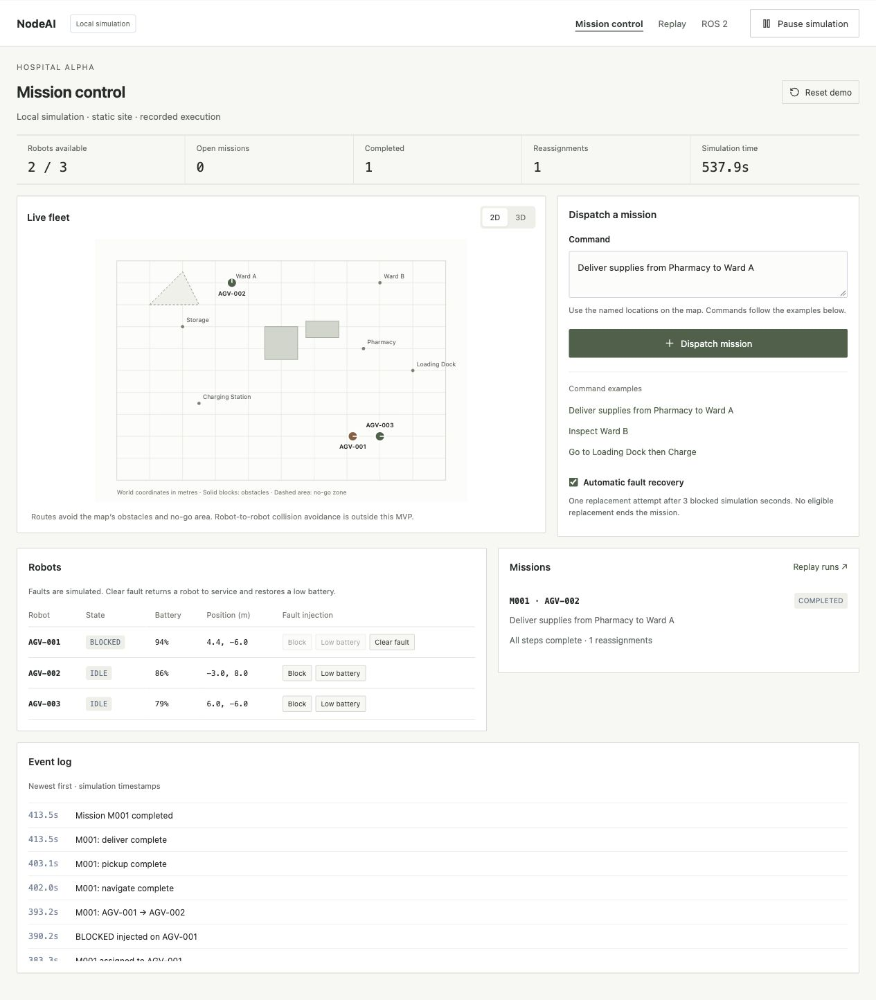
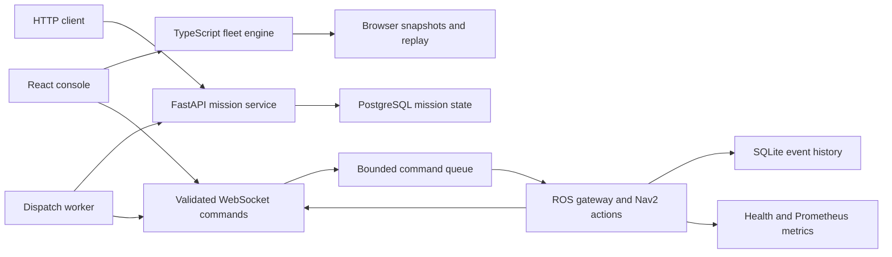

# NodeAI

[](https://github.com/Ekanshthegreat/NodeAI-rework/actions/workflows/ci.yml)

A robot mission console with a browser simulator and a ROS 2 Jazzy / Nav2 bridge.

[Browser demo](https://ekanshthegreat.github.io/NodeAI-rework/) ·
[Architecture](docs/ARCHITECTURE.md) · [ROS setup](docs/ROS2.md) ·
[Persistent missions](docs/MISSIONS.md) · [Operations](docs/OPERATIONS.md) · [Demo guide](docs/DEMO.md)



## Run the simulator

Node.js 24:

```sh
npm ci
npm run dev
```

Try `Deliver supplies from Pharmacy to Ward A`. Block the assigned robot after
pickup to exercise reassignment, then open Replay to inspect the recorded run.
Commands use a small grammar; unsupported instructions fail before dispatch.

## How it fits together



The simulator runs entirely in the browser. ROS control connects to a separate
Python bridge: Nav2 handles planning and motion, while NodeAI handles assignment,
waypoint sequencing and cancellation. The two paths do not share robot state.

| Browser | ROS bridge |
| --- | --- |
| Static-grid routes and simulated cargo handoff | Single pose or up to 20 sequential waypoints |
| Pause, faults and one reassignment attempt | One active goal per robot; hold uncertain outcomes |
| Saved runs, playback and JSON export | SQLite audit, health checks and queue metrics |

## Run the bridge

Follow [ROS setup](docs/ROS2.md) for Jazzy dependencies and robot configuration.
The example config enables local audit storage and diagnostics on port 8766.

```sh
ros2 launch nodeai_bridge bridge.launch.py config_path:=/absolute/path/robots.json
curl http://127.0.0.1:8766/healthz
curl http://127.0.0.1:8766/metrics
```

[Operations](docs/OPERATIONS.md) covers audit export, degraded health and restarts.

For persisted submissions and restart reconciliation, run the
[mission service](docs/MISSIONS.md) with `docker compose --profile demo up --build`.
Its separate worker dispatches through the same ROS bridge.

## Check changes

```sh
npm run format:check
npm run lint
npm run test:run
npm run build
```

CI also runs transport, audit and health checks without ROS, plus the Jazzy
container tests with real action messages. The browser demo needs no hardware;
the ROS tests use a test action server.

## Scope

The simulator uses point robots on a static map; traffic coordination and dynamic
obstacles are outside it. The ROS bridge is a local integration prototype, with
no hardware deployment validation. Audit history records observations; it does
not restore action clients or resume goals after a restart. Older vendor adapters
under `src/adapters/` are outside the supported simulator/ROS paths.

[MIT license](LICENSE) · [Changes](CHANGELOG.md)
