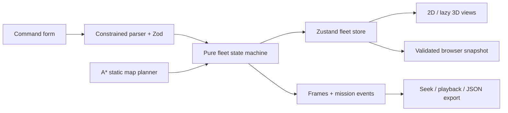

# Architecture

## A mission from input to replay

Start with `src/simulation/engine.ts`. `FleetState` contains the site, robots,
missions, fault map, clock, events and recordings. `submitMission` returns a new
state only after parsing and checking every initial route leg. Each mission has
one assigned robot, a step index and a phase. `tickFleet` advances execution by
100 ms and returns a new state without modifying its input.

The UI calls actions in `src/store/useFleetStore.ts`; it does not move robots or
complete tasks itself. The store applies the returned state, mirrors selected
fields into the older scene view model and saves at action boundaries and every
two seconds. `Layout.tsx` owns the timer and page-hide save. A global pause freezes
the simulated clock; an individual pause leaves other missions running.

## Planning

`src/lib/planner.ts` recognizes a small command grammar and canonical named
locations. It produces a Zod `MissionPlan` rather than executable strings.
Assignment chooses an idle, fault-free robot with sufficient battery, sorting
by battery and then robot ID. This is a deterministic heuristic, not an optimal
fleet scheduler.

`src/lib/planner_path.ts` searches a four-neighbour grid using A* with Manhattan
distance. Edge checks reject rectangle and polygon intersections, including
boundary contact. The planner validates endpoint joins and only removes
collinear waypoints. Unreachable routes throw instead of returning an unsafe
straight line. Planning treats robots as points and does not account for moving
robots or corridor capacity.

## Execution and recovery

Navigation consumes route waypoints at a bounded speed. Other verbs travel to
their location, then perform a short simulated action. Pickup records cargo;
delivery clears it. Charging increases battery until the target is reached.
Completion and cancellation release the robot unless it still has a fault.

A blocked robot waits three simulated seconds before recovery. Low battery can
trigger immediate recovery. Each mission permits one reassignment. A replacement
must be idle, healthy, sufficiently charged and able to reach the next target.
If the failed robot already picked up cargo, the replacement first routes to its
last position and performs a simulated handoff. An unavailable route or exhausted
budget fails the mission. Recovery disabled leaves the assignment in place until
an operator clears the fault or the two-minute active-time deadline expires.
These limits keep the simulation from retrying indefinitely.

## Persistence and replay

`src/simulation/persistence.ts` decodes browser snapshots with bounded Zod
schemas plus cross-reference checks. It rejects conflicting assignments,
stale counters, mismatched mission plans, invalid routes and unordered recording
frames. An unreadable snapshot produces a fresh in-memory demo and a visible
warning; automatic saves leave the unreadable value intact until explicit reset.
Browser storage is not a server database or a synchronization mechanism.

The engine records every 500 simulation ms and at lifecycle transitions. Recorded
mission events are stored with their run, independently of the bounded global
log. `src/simulation/replay.ts` binary-searches the latest frame at or before a
requested time. Replay displays those snapshots; it does not re-execute the
mission or write to the live fleet. Export contains version, mission, site and
recording. Playback is available for terminal runs, including failures and
cancellations. Zero-duration cancellations have a terminal frame and no playable
time interval.

## Reading order and engineering topics

| Read | What to understand |
| --- | --- |
| `lib/schemas.ts`, `types/index.ts` | Contracts and validation boundaries |
| `lib/planner.ts` | Parsing a limited language into structured tasks |
| `lib/planner_path.ts` | A*, collision geometry and safe failure |
| `simulation/engine.ts` | State transitions, deterministic time and bounded retries |
| `simulation/engine.test.ts` | Behavioral invariants and fault scenarios |
| `simulation/persistence.ts` | Safe restoration and cross-reference integrity |
| `store/useFleetStore.ts` | Separating effects from the core model |
| `pages/DashboardPage.tsx`, `pages/ReplayPage.tsx` | UI derived from authoritative state |

The project demonstrates TypeScript, React, state-machine design, search
algorithms, event recording, fault recovery and testable system boundaries. It
does not demonstrate a trained AI planner, deployed robotics stack or verified
hardware integration. Those would require separate implementation and evidence.

## Next milestones beyond the MVP

Traffic reservations and robot footprint clearance; configurable sites; safer
vendor integration contracts backed by device fixtures; run import and server
persistence; and a headless workload benchmark. The optional 3D renderer remains
a large lazy-loaded bundle. The smaller 2D workspace is the default and remains
usable if 3D cannot load.
