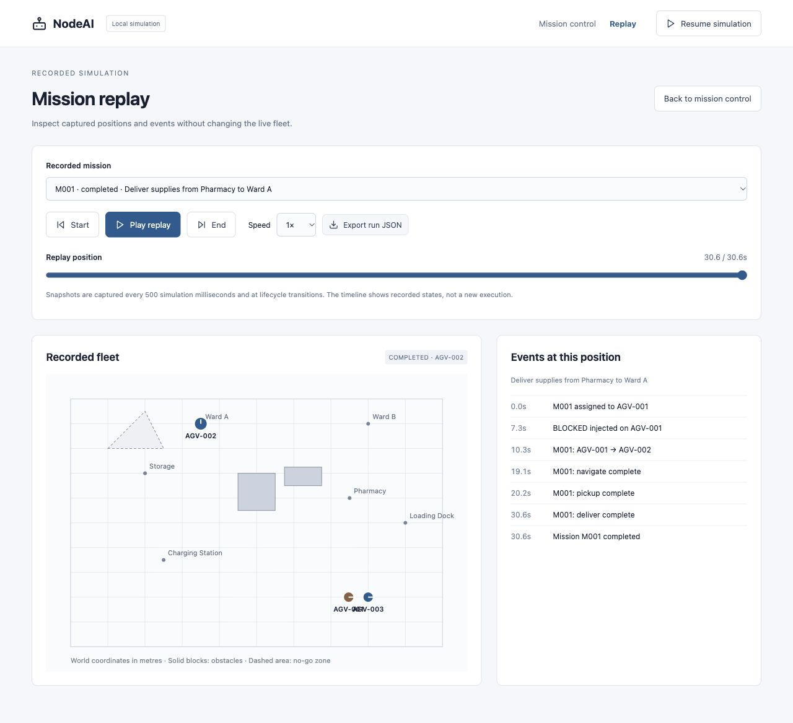

# Demo and manual acceptance checks

Run `npm ci` and `npm run dev`, then open mission control. These scenarios use
synthetic local data and need no credentials.

## Delivery with recovery

Start with the default delivery command. AGV-001 is initially selected because
it has the highest eligible battery. Block it while it is moving. With automatic
recovery enabled, the mission reassigns after three simulation seconds. The
event log records the fault, replacement and task completions. If pickup already
occurred, recovery includes travel to the stopped robot and a simulated cargo
handoff. The delivery ends at Ward A and releases its replacement robot.

## Controls and validation

Dispatch `Inspect Ward B`. Pause that mission, confirm its position does not
change while other activity can continue, resume it, then cancel it. The robot
returns to idle and the cancelled run appears in replay. An immediate cancellation
while the global clock is paused has zero duration.

Try `Deliver supplies to Unknown`: validation should explain the supported
syntax and create no mission. Dispatch three valid missions without letting them
finish; a fourth is rejected because every robot is occupied.

## Failure and service

During a fresh mission, inject low battery on its assigned robot. It reassigns
once. Inject low battery on the replacement: the mission fails with the retry
budget message. Clear both faults to return the robots to local service. Low
battery service restores an 80% battery; this models an operator replacing it.
If all potential replacements are blocked, the mission fails visibly.

With automatic recovery disabled, a blocked mission remains assigned. Clear its
fault to resume movement, or let its active time reach two simulated minutes to
observe a bounded failure.

## Replay, storage and views

Select a completed run in Replay. Play at 4×, pause, seek, jump to End and compare
the event history with the original mission. Export the JSON. Refresh and confirm
that runs, robot state and the global pause setting remain. Export before using
Reset demo if you want to keep a run outside browser storage.

The default 2D map needs no WebGL. Switch to 3D and rotate/zoom the floor schematic;
then switch back. At a 390-pixel viewport the layout stacks, keeping mission
controls and replay accessible without horizontal page scrolling.

## Release verification

Version 0.1.0 was exercised with a blocked delivery that reassigned AGV-001 to
AGV-002 and completed, then replayed and exported. Refresh retained the run.
Invalid input, fault clearing, individual pause/resume/cancel, 3D rendering and
mobile mission/replay layouts were also checked. Automated behavior checks are
in the `*.test.ts` files and run through the CI workflow.

## ROS waypoint acceptance check

Start the labelled action fixture using [ROS setup](ROS2.md), connect the ROS
page, select **Waypoint route**, and send the two default positive-X waypoints.
The event log should progress from 0/2 to 1/2 and then succeed at 2/2. The same
robot remains assigned between legs. Cancel a new route while running: its
terminal event should be cancelled and no remaining leg should start. Set the
second waypoint's X to −1 to exercise a later rejection: the mission fails after
one completed waypoint. The fixture is a ROS action transport test, not a
physical robot or a full Nav2 planner.

After a ROS fixture route succeeds, choose **Export observed events**. The JSON
should identify `test_fixture`, retain the waypoint transitions and finish with
`succeeded` and `completed_waypoints: 2`. Disconnecting keeps the observed log
available; refreshing starts a new browser record.
