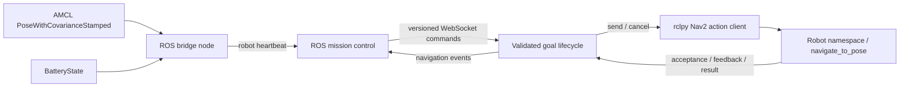

# ROS 2 / Nav2 integration

The v0.2.0 ROS path sends real `nav2_msgs/action/NavigateToPose` goals, subscribes
to localization and battery messages, and reports actual action feedback/results.
It does not execute the local simulator's pickup, handoff, charging or recovery
steps on a physical robot. Those need separate robot-specific handlers.

## Architecture



The ROS page is `/app/ros`, separate from the local fleet executor. Nav2 owns
planning, costmaps and obstacle avoidance. The local A* planner does not issue
hardware routes. The bridge spins a single-threaded ROS executor and handles
WebSockets on a separate asyncio loop, connected through bounded queues.

## ROS host setup

Target platform: ROS 2 Jazzy on Ubuntu 24.04. Install ROS through its supported
installation process, then use a workspace with the `nodeai_bridge` package:

```sh
mkdir -p ~/nodeai_ws/src
cp -R ros2/nodeai_bridge ~/nodeai_ws/src/
cd ~/nodeai_ws
source /opt/ros/jazzy/setup.bash
rosdep install --from-paths src --ignore-src -r -y --rosdistro jazzy
colcon build --symlink-install
source install/setup.bash
ros2 launch nodeai_bridge bridge.launch.py
```

These steps presume `rosdep` and `colcon` are installed and `rosdep` has been
initialized on the ROS host. No ROS installation is needed for the browser app:
run `npm ci` and `npm run dev`, open **ROS 2**, and connect to the bridge.

Copy `ros2/nodeai_bridge/config/robots.json` to a site configuration and pass it
with `ros2 launch nodeai_bridge bridge.launch.py config_path:=/absolute/path/robots.json`.
Use `use_sim_time:=true` when Nav2 uses a simulator clock. Goal timestamps then
use ROS simulation time, while transport/cancellation deadlines and heartbeats
use a steady clock so pausing simulation does not freeze those controls.

Set each robot's namespace-specific action, localization topic, battery topic and
frame ID. The example uses `/agv1/navigate_to_pose` and `/agv2/navigate_to_pose`,
with corresponding AMCL/battery topics. It does not launch Nav2 or configure a
robot's drivers, TF tree, map, localization or costmap.

For a remote ROS host, keep the bridge loopback-only and forward its port:

```sh
ssh -N -L 8765:127.0.0.1:8765 <ros-host>
```

The browser then connects to `ws://127.0.0.1:8765`. Browser origins must match the
configuration's `allowed_origins`; add an exact development/preview origin when
using a different port. The standard configuration accepts local ports 5173 and
4173. It does not support a publicly exposed unauthenticated robot gateway.

## Telemetry and readiness

- Localization is `geometry_msgs/PoseWithCovarianceStamped` from the configured
  frame. Other frames are ignored; this package does not perform TF transforms.
- Quaternion orientation is normalized before deriving planar yaw. Non-finite
  poses and zero-length quaternions are ignored.
- AMCL uses reliable/transient-local QoS; the subscriber matches it. Battery uses
  best-effort/volatile QoS.
- Nav2 must be available and localization received within the configured
  `pose_timeout_seconds` (default 30). This measures receipt age, not a transform
  or sensor-time accuracy guarantee. Stationary AMCL systems may need periodic
  localization updates or an appropriate receipt-age limit.
- Battery percentage is 0–1, or unknown when absent/invalid. Set `require_battery`
  to `true` on a robot to reject goals until valid battery telemetry is available.
  Known battery values below 20%, or stale known readings, block new goals.
- Browser heartbeat freshness is checked separately: goals are disabled after
  three seconds without a robot heartbeat.

## Goal lifecycle

One outstanding goal is permitted per robot. A request ID identifies its exact
payload, so repeating an unchanged retained request reports its current state
without dispatching a second goal. Reusing an ID with different content is
rejected. Terminal history and cancel-request history are bounded to 256 entries;
use fresh UUIDs for new requests. This is bounded in-memory idempotence, not an
across-restart exactly-once guarantee.

States are `pending`, `accepted`, `running`, `cancelling`, `unknown`, `succeeded`,
`cancelled`, `rejected` and `failed`. `accepted` is not completion. Success
requires a terminal action success status and a zero Nav2 error code. A cancel
acknowledgement is not completion either: the robot remains occupied until its
terminal result arrives.

A goal-response timeout holds the assignment. If Nav2 later accepts that goal,
the bridge cancels it rather than resubmitting it. Execution timeout requests
cancellation at 120 seconds. Failed cancellation or missing results leave the
state unknown and the assignment held. No automatic reassignment or manual
"force idle" button is exposed in ROS mode.

Disconnecting/reloading the browser does not cancel a robot goal. Reconnect
heartbeats expose its current request so it can be explicitly cancelled. Bridge
restart loses in-memory history and cannot recover an earlier action handle;
reconcile or stop existing Nav2 goals before issuing commands after a restart.
A full restart-reconciliation protocol and robot task sequencing are next steps.

## Wire contract (version 1)

```json
{"version":1,"type":"navigate","request_id":"a-new-uuid","robot_id":"agv1","target":{"x":1.0,"y":2.0,"yaw":0.0}}
```

```json
{"version":1,"type":"cancel","request_id":"another-uuid","robot_id":"agv1","target_request_id":"a-new-uuid"}
```

Targets are metres and radians in the configured frame: finite X/Y values within
±10,000 and yaw within ±π. The server rejects unknown fields, robots, invalid
IDs and unsupported commands. Messages are limited to 8 KiB; client and queue
counts are bounded. Outbound messages are `hello`, `robots`, `navigation` and
`error`; `src/ros/client.ts` validates them. Transport overload is logged, and
heartbeats reconcile current assignment rather than inventing a terminal result.

## Run the actual ROS tests without hardware

```sh
docker build -f ros2/Dockerfile -t nodeai-ros-test .
docker run --rm nodeai-ros-test
```

The official ROS Jazzy image builds the package with `colcon`. The suite contains
15 pure lifecycle tests and four integration tests using real rclpy action
clients/servers, Nav2 messages and the WebSocket transport. It checks frame/goal
construction, telemetry, feedback, success, rejection, cancellation and denied
browser origins. These tests use a fixture action server; they are not a full
Nav2 navigation-stack, Gazebo, hardware or collision-avoidance validation.

## Browser demonstration fixture

The fixture publishes synthetic localization/battery data and serves real ROS
navigation actions. The browser labels it **ROS 2 action test fixture**. It is
separate from the production bridge configuration.

```sh
docker run --rm -p 127.0.0.1:8767:8765 nodeai-ros-test bash -lc \
  'source /opt/ros/jazzy/setup.bash && source /ws/install/setup.bash && python3 /ws/src/nodeai_bridge/test/demo_nav2.py'
npm run dev -- --host 127.0.0.1 --port 4185
```

Open `/app/ros` on port 4185 and connect to `ws://127.0.0.1:8767`. Positive-X goals
succeed after a short fixture delay; negative-X goals are deliberately rejected.
Cancel an active goal to inspect the full cancellation lifecycle. This fixture
can bind inside its container for Docker port forwarding; the host mapping
remains loopback-only. Ordinary ROS mode requires a loopback listener.

## Primary interface sources

- [Jazzy NavigateToPose action definition](https://github.com/ros-navigation/navigation2/blob/jazzy/nav2_msgs/action/NavigateToPose.action)
- [Jazzy rclpy action client](https://github.com/ros2/rclpy/blob/jazzy/rclpy/rclpy/action/client.py)
- [Jazzy AMCL publisher/QoS](https://github.com/ros-navigation/navigation2/blob/jazzy/nav2_amcl/src/amcl_node.cpp)
- [BatteryState message](https://github.com/ros2/common_interfaces/blob/jazzy/sensor_msgs/msg/BatteryState.msg)
